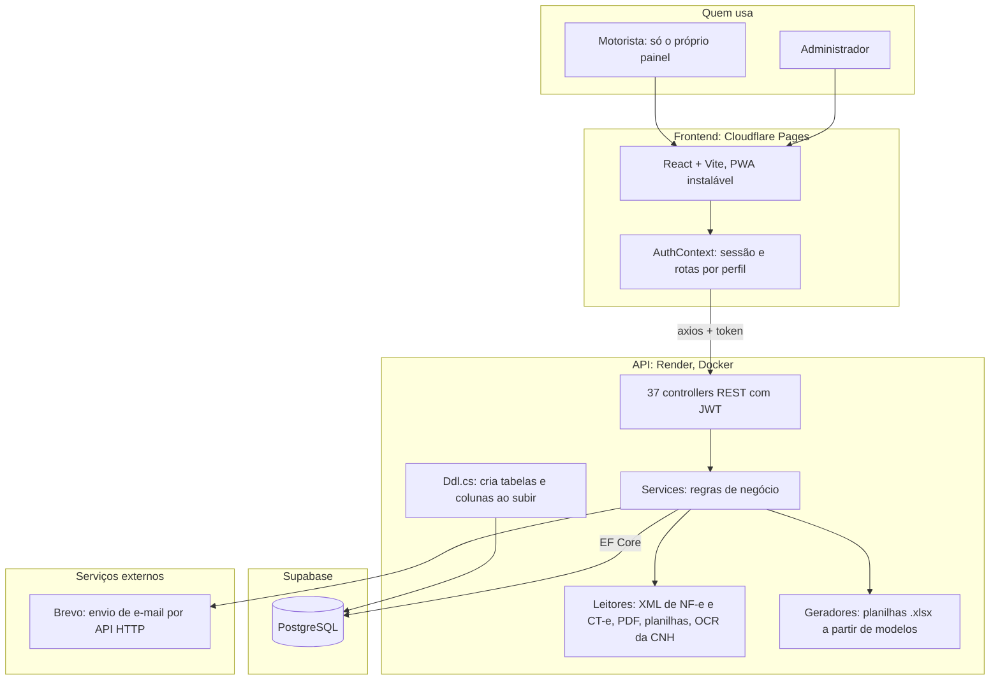
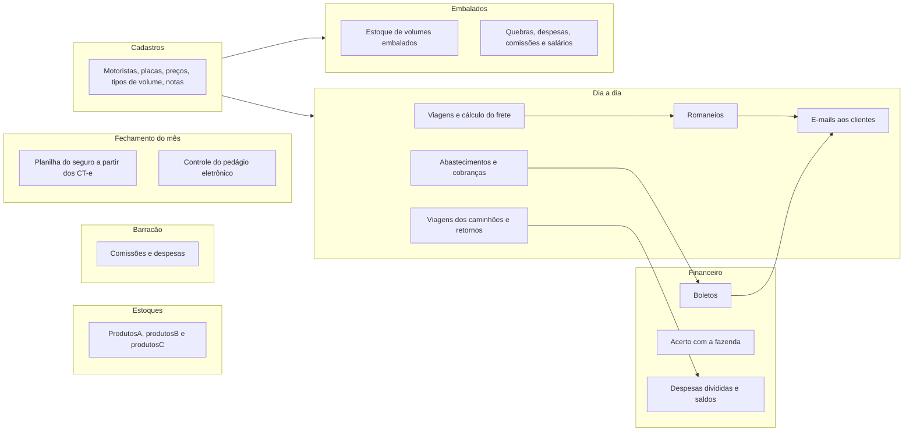

# Sistema de Gestão

Sistema interno de uma transportadora: fretes, viagens dos caminhões, romaneios e e-mails aos clientes,
estoques, abastecimentos, financeiro e fechamento do mês. Tem acesso de administrador e painel do motorista.


## Stack

| Camada | Tecnologia |
|---|---|
| Frontend | React 18 + Vite 5 + TypeScript + Tailwind, react-router, PWA (`frontend/`) |
| API | ASP.NET Core 8, JWT, Swagger (`src/TransportadoraSystem.API`) |
| Regras de negócio | `src/TransportadoraSystem.Application/Services`: leitura de XML, PDF e planilhas, cálculos, Excel, e-mail |
| Dados | EF Core 8 + Npgsql sobre PostgreSQL (Supabase); tabelas novas pelo `Ddl.cs` ao subir a API |
| Arquivos | ClosedXML (gera .xlsx), ExcelDataReader (lê .xls/.xlsx), PdfPig (lê PDF), Tesseract (OCR da CNH) |
| Hospedagem | site na Cloudflare Pages, API na Render (Docker), banco no Supabase; push na `main` publica |

## Mapa da arquitetura



## Mapa dos módulos



## Fluxos principais

```mermaid
flowchart TD
    subgraph Frete[Frete e romaneio]
        A1[XML das NF-e] --> A2[Importação agrupa por destinatário]
        A2 --> A3[Cálculo do frete na tela Viagens]
        A2 --> A4[Romaneio por cliente em .xlsx]
        A4 --> A5[Boletos do cliente anexados]
        A5 --> A6[E-mail semanal pelo Brevo]
    end
    subgraph Abast[Abastecimento]
        B1[Fatura PDF + planilha + boleto do posto] --> B2[Conferência cruzada]
        B2 --> B3[Divisão por posto e resumo a pagar]
    end
    subgraph Viagem[Viagem do caminhão]
        C1[Motorista preenche a folha no painel] --> C2[Acerto: diárias, comissão, sobra em cadeia]
        C2 --> C3[Retornos]
    end
    subgraph Fecha[Fechamento do mês]
        D1[XML dos CT-e] --> D2[Planilha do seguro]
        D3[Planilha do pedágio] --> D4[Controle mensal]
        D2 --> D5[.xlsx exportado]
        D4 --> D5
    end
    subgraph Fazenda[Acerto com a fazenda]
        E1[Upload único reconhece cada arquivo] --> E2[Semana montada com saldo anterior automático]
        E2 --> E3[Planilha do acerto]
    end
```



Não há tarefas agendadas: tudo é disparado pelo usuário. Integração bancária para emitir boletos e emissão de
CT-e e MDF-e por API estão planejadas.

## Rodar e conferir

```bash
dotnet build
```
```bash
cd frontend && npm install && npm run dev
```

Antes de subir: `dotnet build` e `npm run build`, depois teste com arquivos reais (XML, PDF, planilhas).
